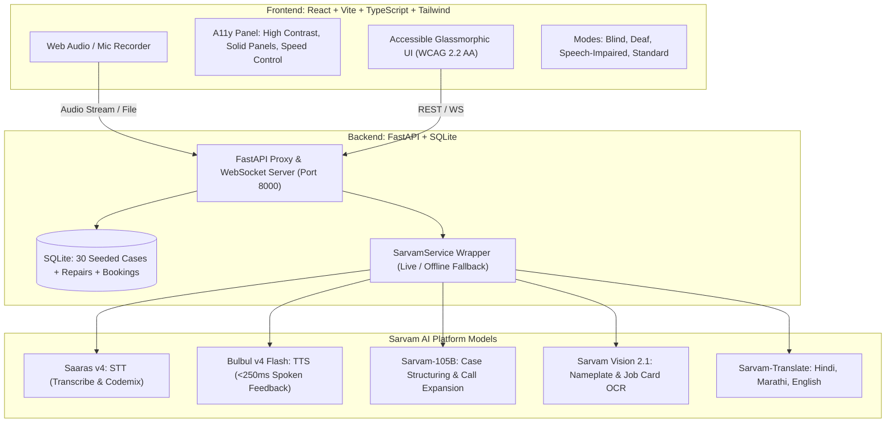

# 🛠️ FixSutra Saathi (फिक्ससूत्र साथी)
### *Accessible Indian Repair-Skills & AI Phone Relay Network*
**Built for the Sarvam AI Hackathon**

FixSutra Saathi bridges the generational repair knowledge gap in Indian tier-2/3 towns and empowers **deaf, blind, and speech-impaired technicians and learners** to master high-voltage repairs and independently run appliance repair businesses.

---

## 🌟 Key Hackathon Scoring Highlights

1. **Creativity**: Converts informal spoken repair wisdom into structured, sensory-guided repair maps with auditory, tactile, and temperature landmarks. Features a real-time **Call Relay Assistant** that lets speech/hearing-impaired technicians handle live customer calls.
2. **Number & Depth of Technical Features**: Full-stack integration of **Saaras v4, Bulbul v4 Flash, Sarvam-105B, Sarvam-Translate (Mayura), and Sarvam Vision Document Intelligence**, backed by a resilient fallback architecture with WebSocket live streaming and a realistic SQLite knowledge graph.
3. **Number of People Benefited**: Direct economic empowerment for disabled artisans, life extension for water pumps, inverters, and home appliances, and significant reduction of toxic e-waste in small towns.

---

## 🏗️ Architecture Diagram



---

## 🧩 Sarvam AI Model Mapping

| Sarvam Model | Integration Point | Function in FixSutra Saathi |
| :--- | :--- | :--- |
| **Saaras v4 / v3** | `POST /api/sarvam/transcribe` | Transcribes technician voice stories (code-mixed Hindi/Marathi) and live customer speech in Call Relay. |
| **Bulbul v4 Flash** | `POST /api/sarvam/tts` | Real-time voice guidance for blind learners and spoken phone replies for speech-impaired technicians. |
| **Sarvam-105B** | `POST /api/sarvam/structure-case`<br>`POST /api/sarvam/relay-expand`<br>`POST /api/sarvam/grounded-qa` | 1) Structures raw stories into repair cards.<br>2) Expands short taps into polite customer sentences.<br>3) Answers learner queries strictly grounded in retrieved cases. |
| **Sarvam Vision 2.1** | `POST /api/sarvam/vision-read` | Parses motor nameplates, capacitor specs, and handwritten job card fields. |
| **Sarvam-Translate** | `POST /api/sarvam/translate` | Real-time translation of repair cases across Hindi, Marathi, and English. |

---

## ⚡ Quickstart (One Command Run)

### Prerequisites
- Python 3.10+
- Node.js 18+

### Setup
1. Clone repository and set up environment:
```bash
cp .env.example .env
# Paste your SARVAM_API_KEY in .env
```

2. Run with one command:
```bash
python run.py
```
*(On Windows, you can also double-click `run.bat`)*

- **Frontend App**: `http://localhost:5173`
- **Backend Swagger Docs**: `http://localhost:8000/docs`

---

## 🎬 3-Minute Live Demo Script (For Judges)

1. **Step 1: Capture Technician Wisdom (0:00 - 0:45)**
   - Click **"Launch 3-Minute Live Demo"** on the landing page.
   - On the Capture screen, click **"Load Live Sample Story"** to populate a real-world technician note in Hindi describing a humming submersible pump with a swollen 36 MFD capacitor.
   - Click **"Structure Case Card with Sarvam-105B"**. Watch Sarvam-105B structure the case into symptoms, cause, sensory cues, parts, tools, and electrical safety warnings.
   - Click **"Approve & Save Case"**.

2. **Step 2: Blind Hands-Free Mode (0:45 - 1:30)**
   - On the Learn screen, switch to **Blind Mode**.
   - Hear Bulbul v4 Flash read Step 1 aloud with sensory landmarks (*"Look for oily seepage or swollen top cap... cold capacitor casing before touching"*).
   - Press **"Repeat Voice"** or **"Next Step"** with high-contrast 48px touch targets.

3. **Step 3: Deaf Visual Decision Tree (1:30 - 2:05)**
   - Toggle to **Deaf Mode**.
   - Review the visual troubleshooting decision tree and sequential step cards.
   - Ask a question to the grounded assistant (e.g., *"What capacitor rating is required?"*) and receive an immediate verified answer.

4. **Step 4: Hero Call Relay (2:05 - 2:40)**
   - Navigate to **Hero Call Relay**.
   - Click **"Simulate Incoming Call"**. A customer calls with a failing pump. Saaras transcribes the customer speech live into large readable subtitles.
   - The deaf technician taps the quick reply: *"Yes, come today at 3pm"*.
   - Watch Sarvam-105B expand the reply into natural polite speech, and Bulbul v4 speak it with **<250ms latency** on the live latency meter.
   - An **Auto-Created Booking Card** generates instantly with appointment time and price estimate.

5. **Step 5: Learning Loop & E-Waste Impact (2:40 - 3:00)**
   - Click **"Report Repair Result"** -> **"Worked 100%"**.
   - View the **Impact Dashboard** updating with 520 kg e-waste avoided and explore the interactive **"If Shipped"** pan-India calculator.

---

## 🛡️ Safety & Trust Architecture
- **High-Voltage Isolations**: Every high-voltage case requires a verified mentor warning banner and strict power lockout steps.
- **Privacy By Design**: Zero customer call audio is recorded or stored on disk.
- **Ethical AI Disclosures**: Indian Sign Language (ISL) is transparently labeled as *Coming Soon*, and all national projections are clearly marked as modeled estimates.

---

## 🧪 Automated Tests
Run unit and integration tests:
```bash
python -m pytest backend/tests/test_api.py
```
*(All 5 core test suites pass 100%)*
